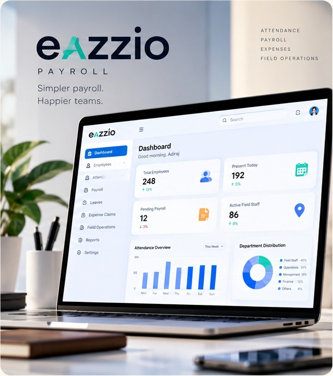
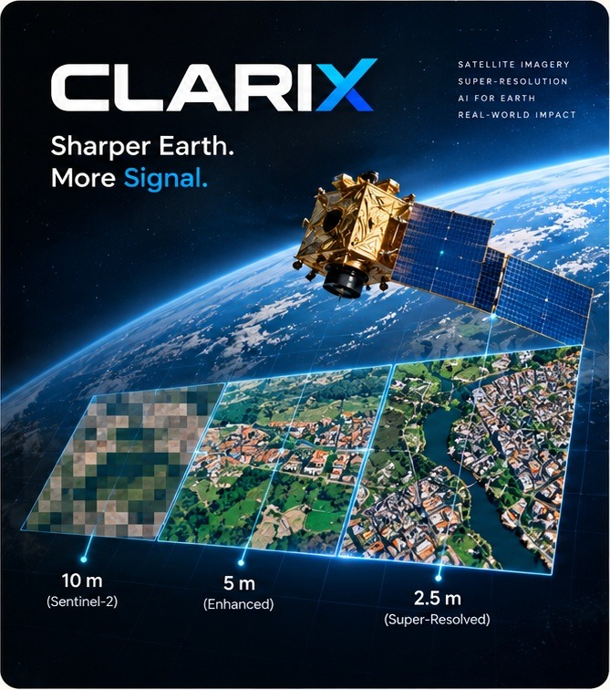
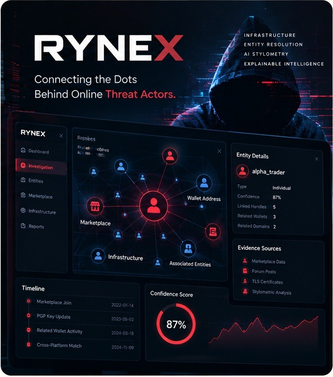

# Aditraj Sharma — Developer Portfolio & Creative Work

[](https://aditrajsharma.github.io/)
[](https://developer.mozilla.org/en-US/docs/Web/HTML)
[](https://developer.mozilla.org/en-US/docs/Web/CSS)
[](https://developer.mozilla.org/en-US/docs/Web/JavaScript)
[](LICENSE)

A personal space where I share what I build, what I learn, and the ideas I bring to life through code and design.

Built with HTML, CSS, and JavaScript, the site brings together my projects, experiments, minimal design with subtle animations and a few details that make it feel like my own.

**Live Website:** [aditrajsharma.github.io](https://aditrajsharma.github.io/)

---

## `01 / What I Explore`

Rather than collecting tools for their own sake, I focus on understanding problems well enough to build working software, explain how it operates, and iterate when I see room for improvement.

<table>
  <tr>
    <td width="33%" valign="top">
      <h4>BUILD</h4>
      <p>Web applications, straightforward architectures, and the small interface details that make a tool intuitive rather than burdensome.</p>
      <sub>HTML · CSS · JS · REACT · NEXT.JS</sub>
    </td>
    <td width="33%" valign="top">
      <h4>INVESTIGATE</h4>
      <p>Applied machine learning, satellite-imagery super-resolution, and cybersecurity intelligence where software helps extract a meaningful signal.</p>
      <sub>PYTHON · SWINIR · ONNX · GRAPH ANALYSIS</sub>
    </td>
    <td width="33%" valign="top">
      <h4>REFINE</h4>
      <p>Data structures, algorithms, foundational systems, and writing clean, reliable code that remains readable when returning to it months later.</p>
      <sub>C · C++ · SYSTEM DESIGN · PROBLEM SOLVING</sub>
    </td>
  </tr>
</table>

---

## `02 / Selected Builds`

Three projects that best reflect how I approach building software — across web engineering, machine learning, and cybersecurity research.

<table>
  <tr>
    <td width="50%" valign="top">
      
      <h3>01 / Eazzio Payroll</h3>
      <p><em>Making routine workplace workflows clearer and less cumbersome.</em></p>
      <p>A web experience designed around everyday payroll operations and employee data management. Built to replace cluttered legacy dashboards with transparent calculations, organized information hierarchy, and a calm, responsive interface.</p>
      <sub>WEB APPLICATION · NEXT.JS · REACT · UI ENGINEERING</sub>
    </td>
    <td width="50%" valign="top">
      
      <h3>02 / ClariX</h3>
      <p><em>Examining the physical world with greater fidelity from above.</em></p>
      <p>A deep-learning project exploring super-resolution reconstruction on Sentinel-2 satellite imagery. The goal is to enhance geospatial image clarity to support more accurate visual assessment and environmental remote sensing analysis.</p>
      <sub>AI / ML · GEOSPATIAL INTELLIGENCE · PYTHON · SWINIR · ONNX · SIH 2026</sub>
    </td>
  </tr>
  <tr>
    <td width="50%" valign="top">
      
      <h3>03 / RYNEX</h3>
      <p><em>Tracing connections hidden beneath digital noise.</em></p>
      <p>An experimental cybersecurity intelligence prototype that maps correlations between online personas, dark-web forum identities, and shared network infrastructure. Utilizes graph entity resolution and AI stylometry to produce explainable attribution clues.</p>
      <sub>CYBERSECURITY · OSINT · GRAPH ANALYSIS · AI STYLOMETRY · SIH 2026</sub>
    </td>
    <td width="50%" valign="top">
      
      <h3>04 / The Visual Archive</h3>
      <p><em>Not every creative outlet needs to be a dashboard.</em></p>
      <p>Alongside programming, I experiment with pixel art, sketches, and visual studies. The portfolio features a standalone gallery capturing these visual side quests and design studies.</p>
      <br />
      <a href="./gallery.html"><strong>Wander through the visual archive ↗</strong></a>
      <br /><br />
      <sub>PIXEL ART · SKETCHES · VISUAL STUDIES</sub>
    </td>
  </tr>
</table>

---

## `03 / The Person Behind the Commits`

Building software for me has always been a balance of two halves: the internal logic that makes a system function reliably, and the human craft that makes it satisfying and effortless to use. Some days are spent untangling a runtime edge case; other days are spent tuning visual pacing, experimenting with an animation, or sketching out an idea on paper.

### Experience

- **Software Development Intern** @ **Thesis Eduventures Pvt Ltd** _(May 2026 – June 2026 · On-site)_  
  Completed a focused software development internship contributing to live feature builds, debugging, and deployment workflows. Gained hands-on experience in cross-functional code reviews, version control discipline, and writing clear developer documentation.  
  [**View Verified Certificate ↗**](https://www.linkedin.com/in/aditraj-sharma-b29068364/overlay/Position/2918767174/treasury/?profileId=ACoAAFpr4lEBQU5OaY8w93GOtRWa6rI95oejR5E)

### Off-Screen

When I step away from the keyboard, you'll usually find me:

- **Brewing coffee:** Pour-overs, experimenting with brew ratios, and medium roasts with tasting notes of jaggery and cacao.
- **Reading:** Physical books on attention, craftsmanship, and quiet persistence.
- **Visual archives:** Collecting references, drawing, and studying editorial typography.

---

## `04 / The Toolkit`

The tools, runtimes, and languages I actively reach for across my projects:

- **Frontend & Web:** HTML5, Modern CSS (Custom Properties, Grid, Keyframes), JavaScript (ES6+), React, Next.js
- **Languages:** Python, C, C++, Java
- **Domains & Exploration:** Applied AI/ML, Geospatial Data, Computer Vision, Cybersecurity / OSINT
- **Environment & Workflow:** Git, GitHub, VS Code, Linux / Windows

_A grounded snapshot of what I use and explore — honest about where I am, and continually learning._

---

## `05 / Behind This Website`

The portfolio itself is intentionally crafted with native web standards: semantic HTML5, modular CSS, and lightweight JavaScript — running with zero external framework dependencies or build pipelines. It features an editorial aesthetic with warm paper tones, custom typography ([Archivo](https://fonts.google.com/specimen/Archivo) and [Space Mono](https://fonts.google.com/specimen/Space+Mono)), an infinite CSS animated wave footer, and a dedicated pixel art gallery.

<details>
  <summary><strong>Peek at the repository structure</strong></summary>

  <br />

```text
portfolio/
├── index.html            # Main portfolio: Hero, Projects, Experience, Off-Screen, Contact
├── gallery.html          # Pixel Gallery & visual artwork page with floating pill nav
├── style.css             # Design tokens, responsive grid systems, and wave animation
├── assets/
│   └── readme-hero.svg   # Handcrafted animated field notes banner
├── images/               # High-resolution project previews & portrait assets
│   ├── clarix.jpg        # ClariX project thumbnail
│   ├── eazzio-payroll.jpg# Eazzio Payroll thumbnail
│   ├── portrait-final.png# Editorial portrait
│   ├── rynex.jpg         # RYNEX project thumbnail
│   └── travel.jpg        # Visual archive preview image
├── gallery/              # Dedicated directory for artwork uploads
├── components/ui/        # Reusable component reference stashes
├── lib/                  # Helper utilities
└── README.md             # This document
```

</details>

<details>
  <summary><strong>Run locally on your machine</strong></summary>

  <br />

Because the core portfolio relies solely on web standards, no `npm install` or compilation step is needed.

**Using Python 3:**

```bash
git clone https://github.com/aditrajsharma/aditrajsharma.github.io.git
cd aditrajsharma.github.io
python -m http.server 3000
```

Then open [http://localhost:3000](http://localhost:3000) in your browser.

**Using VS Code:**  
 Right-click `index.html` and select **"Open with Live Server"**.

</details>

<details>
  <summary><strong>GitHub Pages deployment note</strong></summary>

  <br />

This repository is hosted live via GitHub Pages under the user site convention:

1. Changes pushed to the active branch trigger automatic deployment.
2. In repository **Settings → Pages**, set the source to **Deploy from a branch** with `/ (root)`.
3. The site is served live at [aditrajsharma.github.io](https://aditrajsharma.github.io/).
</details>

---

## `06 / Explore & Connect`

Whether you'd like to discuss a project, talk about software engineering, or share a good book or coffee recommendation, feel free to reach out:

- **Portfolio:** [aditrajsharma.github.io](https://aditrajsharma.github.io/)
- **GitHub:** [@aditrajsharma](https://github.com/aditrajsharma)
- **LinkedIn:** [Aditraj Sharma](https://www.linkedin.com/in/aditraj-sharma-b29068364/)

<br />

<div align="center">
  <p><strong>Still figuring things out. Still building anyway.</strong></p>
  <sub>Handmade by Aditraj Sharma · Set in Archivo &amp; Space Mono.</sub>
  <br /><br />
  <a href="https://aditrajsharma.github.io/"><strong>TAKE A LOOK AROUND THE PORTFOLIO ↗</strong></a>
</div>
